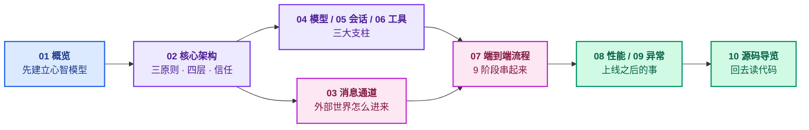
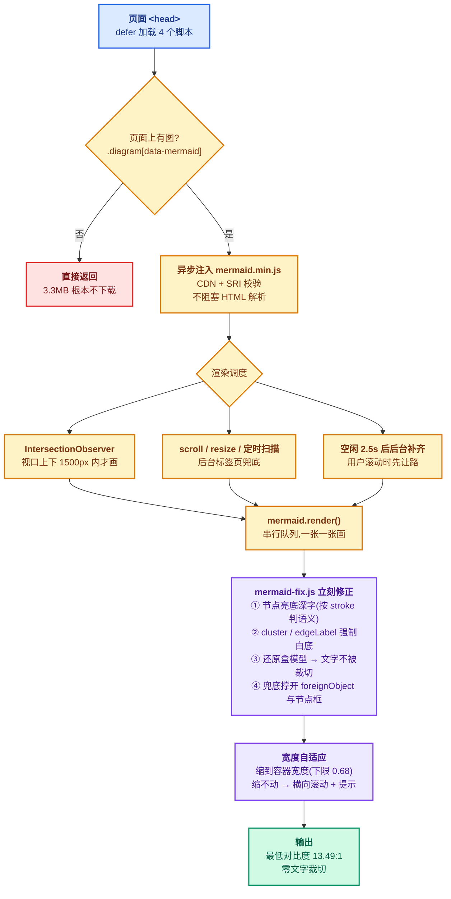

<div align="center">


# notes-openclaw

**OpenClaw 源码解读** — 架构 · 时序 · 源码对照

10 大模块 · 155 张 Mermaid 图 · 22 条时序图 · 约 24 万字

---

[](#-快速开始)
[](#-内容模块)
[](#-技术架构)
[](#-技术架构)
[](#-许可证)

[项目介绍](#-项目介绍) · [阅读价值](#-阅读价值) · [快速开始](#-快速开始) · [内容模块](#-内容模块) · [技术架构](#-技术架构) · [本地部署](#-本地部署) · [验证与常见问题](#-验证与常见问题) · [文档索引](#-文档索引) · [贡献](#-贡献)

</div>

---

##  项目介绍

**notes-openclaw** 是一套针对 **[OpenClaw](https://github.com/openclaw/openclaw)**(Apache 2.0)的源码解读笔记平台 —— 对齐版本 `v2026.9.2` / commit `87d32a44`。

它不是「把文档搬上网」,而是把**架构理解**拆成 10 个可以按顺序读完的模块:每一节都先讲清楚「这一块在整体里占什么位置」,再讲「它怎么工作」,最后给出「怎么验证」。

| 我们不是 | 我们是 |
| --- | --- |
|  一堆 API 文档截图 |  一套**能照着读源码**的架构地图 |
|  只贴时序图不讲为什么 |  每张图都标了**源码路径**与**边界条件** |
|  一堆散装 Markdown |  一个**编号、目录、交叉引用全部自洽**的笔记站 |
|  需要 npm install 才能跑 |  **零构建** —— 纯静态文件,`python3 -m http.server` 就能跑 |

>  **全站 155 张 Mermaid 图全部实测可读** —— 最低文字对比度 **13.49:1**(WCAG AA 要求 4.5:1),零文字裁切,宽图自动缩放或横向滚动。这是本站最花功夫的部分,见 <a href="#-技术架构">技术架构</a>。

---

##  阅读价值

| 支柱 | 价值 | 落地方式 |
| --- | --- | --- |
|  **架构不散** | 10 个模块各有明确边界 | 三原则 + 四层架构 · 三级信任模型 · 6 步通道生命周期 |
|  **对得上源码** | 每节都能落到具体文件 | 167 个代码块 · 243 张表 · 逐节标注 `src/` 路径与行级行为 |
|  **看得见时序** | 22 条时序图还原真实链路 | WhatsApp 全旅程 · 9 阶段端到端 · 31 步消息流 · 崩溃恢复时序 |
|  **量得出来** | 性能与异常不是形容词 | 9 阶段耗时分布 · P50/P95/P99 · 4 类恢复策略 · 5 个关键 SLO |

### 阅读路径怎么走



---

##  快速开始

### 30 秒跑通

```bash
# 1. 拉代码
git clone git@github.com:Lianjifu/notes-openclaw.git
cd notes-openclaw

# 2. 起静态服务器(任意静态服务器都行)
python3 -m http.server 8000

# 3. 打开浏览器
open http://localhost:8000
```

> 没有 `npm install`,没有 `package.json`,没有构建步骤 —— 仓库里就是最终产物。

### 验收清单

| # | 检查项 | 预期 | 怎么看 |
| --- | --- | --- | --- |
| 1 | 站点能打开 | 首页显示 10 个模块卡片 | <http://localhost:8000> |
| 2 | 侧栏可点 | 平铺 10 项 + 首页,当前页高亮 | 点任意模块名 |
| 3 | 图能画出来 | 155 张 Mermaid 全部渲染 | 往下滚,图逐张出现 |
| 4 | 目录能跳 | 右侧「本文目录」点击定位 | 滚到 § 6 点链接 |
| 5 | 暗色可切 | 顶栏「暗色 / 亮色」切换,图仍清晰 | 切暗色看任意一张图 |
| 6 | 移动端不塌 | 375px 宽无横向滚动条 | 浏览器缩窄到 375px |
| 7 | 搜索能命中 | 搜「沙箱」「时序」「信任」有结果 | <http://localhost:8000/search.html> |

>  **需要联网**:Mermaid 从 `cdn.jsdelivr.net` 加载(带 SRI 校验)。离线时文字与布局完全正常,只有图会缺。

---

##  内容模块

### 10 个模块总表

| # | 模块 | 回答什么 | 篇数 | 图 |
| --- | --- | --- | --- | --- |
| 01 | [概览](01-overview.html) | OpenClaw 是什么?设计哲学是什么?与同类差在哪 | 3 | 3 |
| 02 | [核心架构](02-architecture.html) | 三原则、四层架构、Gateway 7 子模块、5 条接口契约、三级信任 | 4 | 45 |
| 03 | [消息通道](03-channels.html) | 通道插件、协议帧、15+ 通道清单、字段映射、附件与出站 | 3 | 18 |
| 04 | [模型与运行时](04-models-runtimes.html) | Provider/Model/Runtime 区分、5 种 Runtime、4 级选择、Fallback | 4 | 18 |
| 05 | [会话与状态](05-sessions.html) | 生命周期、SQLite + Markdown 分层、8 层 Prompt、DM 隔离 | 4 | 29 |
| 06 | [工具与钩子](06-tools-hooks.html) | 工具执行、4 档沙箱、3 大类钩子、8 个核心决策 | 3 | 9 |
| 07 | [端到端流程](07-end-to-end.html) | WhatsApp 完整旅程、13 参与者、9 阶段、31 步时序 | 3 | 5 |
| 08 | [性能与延迟](08-performance.html) | 9 阶段耗时、TTFT 优化、5 大类优化手段、实操清单 | 3 | 5 |
| 09 | [异常与降级](09-error-handling.html) | 5 大类错误、4 种恢复策略、可观测性 4 件套、关键 SLO | 3 | 6 |
| 10 | [源码导览](10-source-walkthrough.html) | 顶层目录、`src/` 7 大模块、`packages/`、`extensions/`、`apps/` | 5 | 17 |

### 内容规范

每个模块页都遵循同一副骨架 —— 这是全站编号、目录、交叉引用能保持自洽的前提:

```
§ 1  一句话定位        一段话讲清这个模块是什么
§ 2  三个原则          可迁移的判断依据,而不是功能罗列
§ 3  模块位置          在整体架构中的位置 + 与相邻模块的关系
§ 4 .. N  主题详解     按逻辑分组,每节只讲一件事
§ N+1  阅读路径 + FAQ + 总结
```

正文里所有指向小节的交叉引用(`§ 6`、`模块 01 § 2`、区间 `§ 4-8`)都指向**真实存在**的小节,结构一变就由脚本统一重写。

### 5 个重点模块详解

#### ① 核心架构 — 三原则 · 四层 · 信任边界

- **三原则**:可信的网关(单一长期运行的进程掌握全部密钥 / 会话 / 通道连接)· 不可信的执行(LLM 推理与工具执行都在网关隔离之外)· 确定性的策略(策略声明式配置,不散落在执行上下文)
- **四层架构**:L1 接入层 → L2 编排层 → L3 推理层 → L4 持久层,每层只与相邻层交互,层间接口稳定
- **Gateway 7 子模块**:`server.ts` / `router.ts` / `queue.ts` / `envelope.ts` / `schema-validator.ts` / `auth.ts` / `auth-rate-limit.ts`
- **5 条接口契约**:Envelope · ToolCall · RpcRequest · Outbound · Provider
- **三级信任模型**:TRUSTED(Gateway 内部)→ SEMI-TRUSTED(LLM 响应)→ UNTRUSTED(外部输入)

#### ② 消息通道 — 从平台协议到统一 Envelope

- 15+ 内置通道,5 种连接模式(WebSocket 长连接 / Webhook 推送 / Long Polling / 本地管道 / 桥接)
- 通道插件运行在 Gateway 进程内,凭据与连接状态由 Gateway 统一管理
- 平台特异性细节(原始事件、流式卡片、附件 URL)在适配器内归一化 —— **Gateway 永远只看 Envelope**
- 7 步生命周期:注册 → 初始化 → 连接 → 收消息 → 处理 → 重连 → 关闭
- 字段映射三视角:WhatsApp / Slack / Telegram 各一张对照表

#### ③ 会话与状态 — 8 层 Prompt 是怎么叠出来的

- 4 种会话类型(Main / Branch / Sandbox / Isolated),6 个生命周期状态
- 会话 ID 三元组:`channel + account + peer`,跨账号上下文要显式开启
- 3 层存储:SQLite(机器可读,任务控制)· Markdown(人类可读,长期记忆)· Git(可选,版本层)
- 8 层 Prompt 栈:System → Tools Schema → Memory → History → Skill Context → User Input → Attachments → Meta
- 4 级 DM 策略:Open → Pairing → Allowlist → Closed

#### ④ 性能与延迟 — 瓶颈到底在哪

- 9 阶段耗时分布:**约 75% 的时间花在 LLM 推理上**,Gateway 自身开销 < 100ms
- TTFT 优化是收益最大的一档 —— 流式让用户在 1-3s 就看到首个 token
- 5 大类优化:模型层 · Prompt 层 · 流式层 · 并发层 · 架构层
- prompt caching 典型场景成本下降 50-80%、延迟减少 30-50%
- 每类优化都带配置示例,末尾附**实操检查清单**

#### ⑤ 异常与降级 — 失败时会发生什么

- 5 大类错误:通道 · 网关 · Agent · 工具 · 配置
- 4 类恢复策略:指数退避重试 · Fallback chain · 熔断 · 静态兜底降级
- 可恢复性矩阵:每类错误 × 能不能重试 / 要不要降级 / 告不告警
- 可观测性 4 件套:Metrics · Logs · Traces · Alerts
- 5 个关键 SLO:成功率 99.5% · TTFT · 端到端延迟 · 工具成功率 · 队列积压

---

##  技术架构

### 设计原则

1. **零构建** — 仓库里就是最终产物。改完 HTML 刷新即见,不需要编译、不需要起 dev server
2. **内容与渲染分离** — 正文是纯 HTML + `data-mermaid` 属性,渲染逻辑完全在 `assets/` 里,换主题/换图表库不动正文
3. **编号自洽** — 小节编号、右侧目录、正文交叉引用由同一套脚本生成与重写,不会各自漂移
4. **图要看得清** — 渲染不是终点,**可读性**才是:对比度、文字裁切、宽图处理逐项兜底
5. **能左到右就左到右** — 流程图默认 `flowchart LR`(106 张),只有真正需要纵向堆叠的才保留 TB(24 张)

### Mermaid 渲染管线

这是全站最花功夫的部分 —— 155 张图要在大到能读的尺度上、在任意主题下、在任意屏宽下都清晰:



### 技术栈

| 层 | 选型 | 说明 |
| --- | --- | --- |
| 内容 | HTML5 + 原生 CSS | 无框架、无预处理器、无 CSS 变量编译 |
| 脚本 | 原生 JS(ES5+) | 4 个脚本,全部 `defer`,无打包 |
| 图表 | Mermaid 11.15.0 | CDN + SRI,按需加载 |
| 主题 | CSS 变量 + `localStorage` | 亮/暗两套,首屏无闪烁 |
| 搜索 | 客户端全量匹配 | 35 篇文章的元数据索引 |
| 部署 | 任意静态托管 | GitHub Pages / Vercel / Netlify / Cloudflare Pages |

### 仓库结构

```
.
├── index.html                  # 首页:模块目录、按角色入口、硬数据快照
├── 01-overview.html            # 01 概览
├── 02-architecture.html        # 02 核心架构
├── 03-channels.html            # 03 消息通道
├── 04-models-runtimes.html     # 04 模型与运行时
├── 05-sessions.html            # 05 会话与状态
├── 06-tools-hooks.html         # 06 工具与钩子
├── 07-end-to-end.html          # 07 端到端流程
├── 08-performance.html         # 08 性能与延迟
├── 09-error-handling.html      # 09 异常与降级
├── 10-source-walkthrough.html  # 10 源码导览
├── search.html  tags.html  articles.html   # 搜索 / 标签云 / 文章索引
├── sitemap.xml  rss.xml
├── docs/
│   └── images/
│       ├── brand/logo-wordmark.svg
│       └── icons/*.svg          # README 与站点共用的图标
└── assets/
    ├── gitbook.css             # 全部样式(设计变量 + 组件 + 响应式)
    ├── site.js                 # 主题、面包屑、进度条、侧栏注入、锚点定位
    ├── platform.js             # 代码复制、文章列表、标签云、搜索
    ├── nav.js                  # 移动端侧栏切换、当前页高亮
    ├── mermaid-render.js       # Mermaid 按需加载 + 调度(核心)
    ├── mermaid-fix.js          # 渲染后样式强制修正(核心)
    ├── sidebar.html            # 侧栏组件(运行时 fetch 注入,全站复用)
    └── articles.json           # 35 篇文章的元数据与跳转锚点
```

---

##  本地部署

### 环境

| 项 | 要求 | 说明 |
| --- | --- | --- |
| 运行时 | 任意静态服务器 | `python3 -m http.server` / `npx serve` / nginx 都行 |
| 浏览器 | 支持 ES6 + IntersectionObserver | Chrome / Edge / Safari / Firefox 近两年版本 |
| 网络 | 首次访问需联网 | 只为拉 CDN 上的 mermaid |
| 依赖 | **无** | 没有 `package.json`,不需要 `npm install` |

### 端口

| 端口 | 用途 | 备注 |
| --- | --- | --- |
| 8000 | 本地预览 | `.claude/launch.json` 里已配好 `docs-site` 启动项 |

### 部署到线上

```bash
# GitHub Pages
#   Settings → Pages → Source: Deploy from a branch → main / (root)
#   注意:不要设 build command —— 这个项目没有构建步骤

# Vercel / Netlify / Cloudflare Pages
#   Build command:  留空
#   Output directory: /
```

页面里用的全是**相对路径**(`assets/xxx.js`),部署到子目录也不用改配置。上线前记得把 `sitemap.xml` / `rss.xml` 里的 `<loc>` 换成真实域名。

---

##  验证与常见问题

### 本次重构的验证口径

全站改造完成后跑了一遍回归,结果如下:

| 检查项 | 口径 | 结果 |
| --- | --- | --- |
| 图能渲染 | 10 个页面全部 mermaid.render() |  155 / 155 |
| 文字对比度 | 1957 处文字逐一计算 WCAG 比值 |  最低 13.49:1(要求 ≥ 4.5) |
| 文字裁切 | foreignObject 内容高度 vs 量得的高度 |  0 处 |
| 小节编号 | 逐页比对编号与层级 |  0 处跳号 / 重号 |
| 交叉引用 | 每条 `§ N` 是否指向存在的小节 |  0 处失效 |
| 目录锚点 | 右侧目录每条链接是否可解析 |  0 处失效 |
| HTML 标签 | section / div / h2-h4 / ul / table… 配平 |  10 页全通过 |
| 横向溢出 | 375 / 768 / 1440 / 1920 四档 |  0 处溢出 |
| 首屏性能 | `02-architecture.html`(45 张图) | DOMContentLoaded 73ms · load 131ms |

### 常见问题

**Q:离线打开,图全没了怎么办?**
A:图的源码以 `data-mermaid` 属性存在 HTML 里,离线时页面文字与排版完全正常。想离线看图,下载一份 `mermaid.min.js` 放到 `assets/`,把 `mermaid-render.js` 里的 `MERMAID_URL` 改成相对路径即可。

**Q:宽图看不全,是不是渲染有问题?**
A:不是。可读的图会优先等比缩到容器宽度(下限 0.68,低于这个值文字就太小了);缩不动才横向滚动,并显示「← 可横向滚动查看完整图 →」提示,左右两端都滚得到。

**Q:暗色模式下图里的字看不清?**
A:`mermaid-fix.js` 在渲染完成后强制把节点改成「亮底 + 深字」,不跟随主题 —— 两套主题下对比度都是 13.49:1。

**Q:新增一篇模块页要改哪些地方?**
A:`assets/sidebar.html`(侧栏条目)、`assets/articles.json`(文章元数据)、以及站内其它页面里的链接。编号、右侧目录、交叉引用会由脚本统一重排,不用手工对。

**Q:改完静态资源,浏览器还是旧的?**
A:全站引用都带 `?v=<token>`,token 全站一致。改完资产把 token 统一 bump 一次即可。

---

##  文档索引

| 文档 | 路径 | 用途 |
| --- | --- | --- |
| **模块正文** | [`01-overview.html`](01-overview.html) … [`10-source-walkthrough.html`](10-source-walkthrough.html) | **10 篇模块正文** —— 每篇含架构图 / 时序图 / 源码路径 / 自检清单 |
| **文章索引** | [`articles.html`](articles.html) | 35 篇文章的完整目录,按模块与标签分组 |
| **标签云** | [`tags.html`](tags.html) | 按标签浏览(概览 / 三原则 / 架构 / 时序 / 性能 …) |
| **全文搜索** | [`search.html`](search.html) | 客户端搜索,支持高亮 |
| **RSS** | [`rss.xml`](rss.xml) | 订阅更新 |
| **站点地图** | [`sitemap.xml`](sitemap.xml) | 搜索引擎索引 |
| **品牌资产** | [`docs/images/`](docs/images/) | Logo 字标 · 27 个图标 |

---

##  贡献

欢迎所有形式的贡献 —— 勘误、补充、画图、提 Issue。

### 贡献方式

-  **报告 Bug** — [Issues](https://github.com/Lianjifu/notes-openclaw/issues) 选 `bug` 模板
-  **提需求** — [Issues](https://github.com/Lianjifu/notes-openclaw/issues) 选 `feature` 模板
-  **改进内容** — 直接提 PR,改对应模块页的 HTML 即可
-  **讨论** — [Discussions](https://github.com/Lianjifu/notes-openclaw/discussions)

### 开发流程

1. Fork 仓库
2. 创建分支(`git checkout -b feat/xxx`)
3. 提交(`git commit -m "docs(scope): description"`)
4. 推送(`git push origin feat/xxx`)
5. 创建 PR

### 提交规范

**Conventional Commits**:

```
docs(scope): 内容变更
fix(scope): 修错
feat(scope): 新增功能
refactor(scope): 重构(无内容变化)
chore(scope): 杂项
```

### 工程约定

- **正文只放内容**,渲染逻辑一律在 `assets/`;不要在模块页里写 `<script>`
- **加图用 `data-mermaid` 属性**,不要手写 SVG —— 渲染与样式修正会自动接管
- **流程图默认左到右**(`flowchart LR`),只有真正需要纵向堆叠的才写 TB
- **改完静态资源要 bump token**:全站引用都带 `?v=`,改完统一换一次
- **改了结构要重排编号**:小节号、右侧目录、正文交叉引用是联动的,别只改一处
- 本地没有构建与测试环节 —— 改完起个静态服务器,肉眼过一遍 + 跑一遍 <a href="#-验证与常见问题">验证清单</a> 即可

---

##  许可证

解读对象 **OpenClaw** 遵循 **Apache License 2.0**,版权归 [openclaw/openclaw](https://github.com/openclaw/openclaw) 所有;本站是对该第三方项目的解读与整理。

本仓库(文档站本身)的许可由仓库所有者指定,详见仓库根目录的 `LICENSE`。

```
Copyright 2026 notes-openclaw Contributors

Licensed under the Apache License, Version 2.0 (the "License");
you may not use this file except in compliance with the License.
You may obtain a copy of the License at

    http://www.apache.org/licenses/LICENSE-2.0
```

---

<div align="center">

**[ 回到顶部](#notes-openclaw)**

Made with  for the OpenClaw community

</div>
